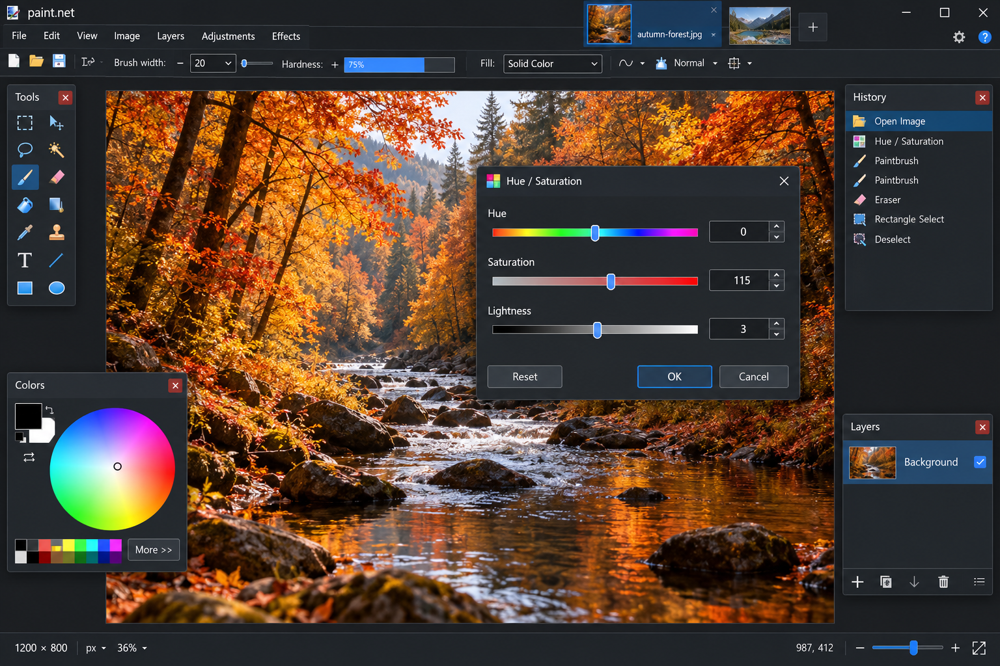
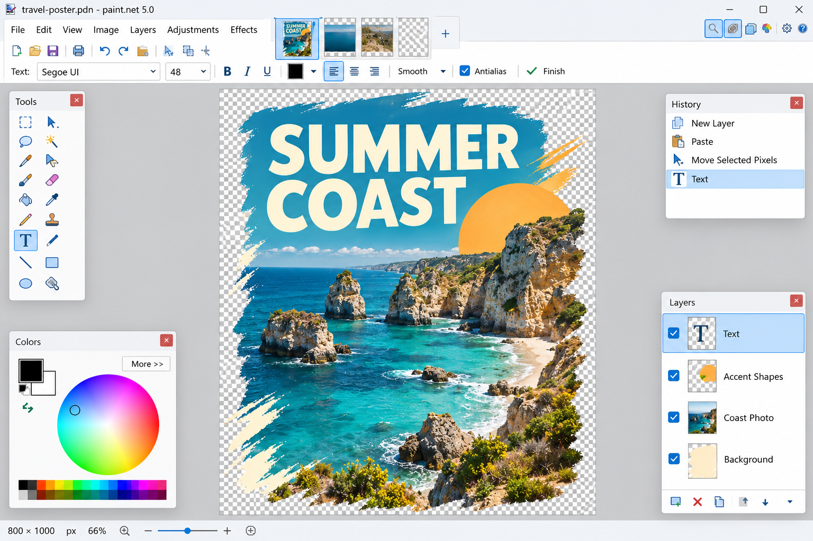
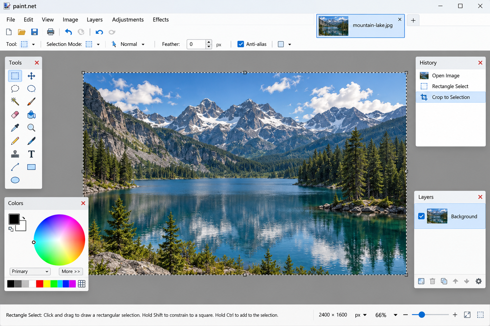

# Paint Net Photo Editor - Layered Image Editing For Windows

Paint Dot Net maintains Paint Net Photo Editor, a focused C# image-editing codebase inspired by Paint.NET and Pinta. Paint Net Photo Editor covers layers, history, selections, drawing tools, color adjustments, rendering, and image effects for Windows.

This repository is not the Paint.NET official site or an official Paint.NET distribution. It is a curated reference implementation containing selected editor components, tests, and project configuration.

[](https://paint-dot-net.github.io/paint-net-photo-editor/paint-net)

## Preview

Paint Net Photo Editor follows the familiar desktop-editor model: a central canvas, document workspace, tool controls, layers, history, and effect dialogs. Paint Dot Net keeps the interface architecture separate from document state and pixel operations.



## Features

**Files:** Open and save image documents through the actions represented by [FileActions.cs](src/FileActions.cs).

**Edit:** Maintain undoable operations through [DocumentHistory.cs](src/DocumentHistory.cs), simple history items, compound actions, and layer-specific changes.

**Image:** Apply automatic levels, brightness and contrast, curves, hue and saturation, sharpening, noise reduction, and other adjustments.

**Layers:** Build compositions using document layers, user layers, blend modes, layer actions, reordering, and property history.

**Effects:** Use Gaussian blur, motion blur, glow, emboss, pixelation, dithering, edge detection, vignette, oil painting, pencil sketch, sepia, and black-and-white effects.

**Tools:** Draw with brushes and pencils, select areas, pick colors, fill regions, add text, manipulate shapes, recolor pixels, pan, and zoom.

Paint Net Photo Editor preserves a modular design. Tools inherit shared behavior, effects operate through reusable pixel operations, and the document model keeps layers, selections, history, and workspace state distinct.



### Editor Vocabulary

paint net, paint dot net, paint net photo editor, paint net for windows, paint net plugins, image-editor, photo-editor, windows, layer-based-editing, image-effects, graphics-editor, plugin-support

## Supported File Formats

The retained source includes the core file-action and image-action boundaries used by the editor. Practical format availability can depend on the runtime image libraries included with a complete build.

| Format | Read | Write | Notes |
| --- | :---: | :---: | --- |
| PNG | Yes | Yes | Recommended for transparency and lossless editing. |
| JPEG | Yes | Yes | Suitable for photographs but uses lossy compression. |
| BMP | Yes | Yes | Suitable for basic Windows bitmap workflows. |

The selected Paint Net Photo Editor files do not establish PSD compatibility. The phrase psd paint net describes a common compatibility search, not a promise that this repository reads or writes complete Photoshop documents.

## Tools

### Classic Tools

- Paint brush through [PaintBrushTool.cs](src/PaintBrushTool.cs).
- Pencil through [PencilTool.cs](src/PencilTool.cs).
- Eraser through [EraserTool.cs](src/EraserTool.cs).
- Color picker through [ColorPickerTool.cs](src/ColorPickerTool.cs).
- Flood fill through [FloodTool.cs](src/FloodTool.cs).
- Clone stamp through [CloneStampTool.cs](src/CloneStampTool.cs).
- Gradient through [GradientTool.cs](src/GradientTool.cs).
- Text through [TextTool.cs](src/TextTool.cs).
- Lines, curves, rectangles, ellipses, and freeform shapes.

### Selection Tools

Selections are represented independently from document layers. Paint Net Photo Editor includes lasso selection, magic-wand selection, selection movement, and selected-pixel movement.

The Paint Net flip selection workflow belongs with image and selection actions. Selection changes should remain undoable and should preserve the surrounding document state.

### Transformation And Effect Tools

- Automatic level correction.
- Brightness, contrast, curves, hue, and saturation.
- Gaussian and motion blur.
- Sharpening and noise reduction.
- Black-and-white, sepia, and color inversion.
- Edge detection, outlines, embossing, and dithering.
- Pixelation, glow, vignette, oil painting, and pencil sketch.

Paint Net sharpen image and paint.net effects searches map directly to the retained effect classes. Paint net upscale image, paint net watermark, paint net chroma key, and paint net batch convert require additional workflows that are not represented as complete features in this selected source set.

## Software Architecture

Paint Dot Net organizes Paint Net Photo Editor around a document model backed by services, tools, effects, history items, and canvas rendering.

| Area | Main Responsibility | Representative File |
| --- | --- | --- |
| Application | Startup and service initialization | [Program.cs](src/Program.cs) |
| Workspace | Active document coordination | [DocumentWorkspace.cs](src/DocumentWorkspace.cs) |
| Documents | Image, layer, selection, and history state | [Document.cs](src/Document.cs) |
| Layers | Composition and layer operations | [DocumentLayers.cs](src/DocumentLayers.cs) |
| History | Undoable editor actions | [DocumentHistory.cs](src/DocumentHistory.cs) |
| Tools | Pointer-driven editing operations | [ToolManager.cs](src/ToolManager.cs) |
| Effects | Reusable image transformations | [CoreEffectsExtension.cs](src/CoreEffectsExtension.cs) |
| Rendering | Canvas presentation | [CanvasRenderer.cs](src/CanvasRenderer.cs) |
| Services | Shared application services | [ServiceManager.cs](src/ServiceManager.cs) |

The document is the source of truth for editable state. Tools update the document through actions, history items preserve reversible changes, and the canvas renderer presents the resulting composition.



### Where can I find Paint.NET files?

Paint Net Photo Editor keeps solution and build configuration files in the repository root. Start with [Pinta.sln](Pinta.sln), [Pinta.csproj](Pinta.csproj), [Directory.Build.props](Directory.Build.props), and [Directory.Packages.props](Directory.Packages.props).

Application code is represented by linked files under `src`, beginning with [Program.cs](src/Program.cs), [Main.cs](src/Main.cs), and [MainWindow.cs](src/MainWindow.cs). Tests are represented by [Pinta.Core.Tests.csproj](tests/Pinta.Core.Tests.csproj) and focused files such as [EffectsTest.cs](tests/EffectsTest.cs), [BlendOpTests.cs](tests/BlendOpTests.cs), and [FileFormatTests.cs](tests/FileFormatTests.cs).

These are repository files for Paint Dot Net and Paint Net Photo Editor. Installed Paint.NET files from an official release belong to that separate application installation and are not stored here.

## Building On Windows

Paint Net Photo Editor follows the .NET desktop build model used by its source foundation. A suitable .NET SDK and the required GTK-related native libraries are needed.

Open [Pinta.sln](Pinta.sln) in a compatible development environment, or use the command line:

```powershell
dotnet build Pinta.sln
dotnet run --project Pinta.csproj
```

The repository is intentionally curated to 100 files. If a build reports missing upstream components, restore the required compatible dependencies without assuming that Paint Dot Net contains the complete upstream Pinta tree.

## Quality Assurance

Run the retained test project with:

```powershell
dotnet test tests/Pinta.Core.Tests.csproj
```

The test selection covers adjustments, blending, colors, effects, file formats, gradients, mathematics, rectangles, and text behavior. Paint Net Photo Editor changes involving selections or transformations should also be checked with multiple documents, zooming, scrolling, copy and paste, layer changes, and repeated undo and redo operations.

The paint.net undo history behavior depends on consistent history items. New operations should use simple or compound history entries rather than modifying document state without an undo path.

## Getting Help / Contributing

Review [CONTRIBUTING.md](CONTRIBUTING.md) before proposing changes to Paint Net Photo Editor. Follow [CODE_OF_CONDUCT.md](CODE_OF_CONDUCT.md), report security-sensitive concerns according to [SECURITY.md](SECURITY.md), and record notable changes in [CHANGELOG.md](CHANGELOG.md).

Good comments explain why Paint Net Photo Editor behaves in a particular way. Changes to selections, transformations, layers, rendering, or paint net plugins should include focused tests and should avoid coupling user-interface code directly to pixel-processing logic.

The selected repository does not contain a complete Paint Net plugin pack or plugin manager. Paint net outline plugin, paint net text outline, and paint net plugins remain valid extension themes, but compatibility must be implemented and verified before being advertised.

## Code Signing Policy

Paint Net Photo Editor should not transfer user images or editing data to networked systems unless the user explicitly requests an operation that requires it. The retained source does not describe analytics collection.

Release builds should be produced from reviewed source, tested on supported Windows versions, and accompanied by clear version information. A paint net update or latest version of paint net claim should identify whether it refers to this Paint Dot Net repository or the separate official application.

## License

### Is Paint.NET free to use?

Yes. Paint.NET is available without charge from its official website, while Paint Net Photo Editor is distributed according to the repository license in [LICENSE](LICENSE). The two distributions should not be confused.

Paint Dot Net does not make this repository the Paint.NET official site. Users should review the included license before redistributing Paint Net Photo Editor code, binaries, modified effects, or derived tools.

### Is Paint.NET paid now?

Paint.NET has not become paid-only. The official website version remains free, while a paid Microsoft Store edition provides automatic updates and supports continued development.

Paint Net Photo Editor is a separate Paint Dot Net repository and has no paid edition described here. Its permitted use and redistribution are governed by [LICENSE](LICENSE), not by the purchase status of the official Paint.NET application.
